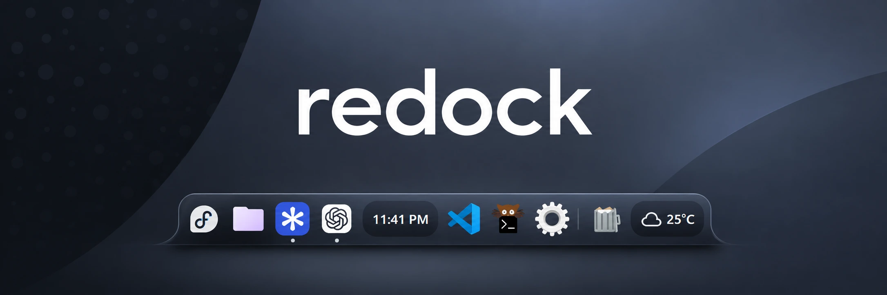
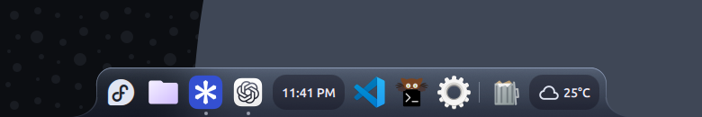

# Redock

A glass dock that meets the bottom edge of your desktop. Curved ends and a soft rim over Dux Shell’s native dock, with your own apps, icons, and wallpaper.



## Install

Tested with **Dux Shell 2.1.0 and 2.1.2**, **Hyprland 0.57.1**, and **Qt 6.11**. You’ll need a systemd-managed DMS session, Python 3.11+, GNU patch, and Qt 6 Shader Baker (`qsb`). On Fedora, `qsb` comes with `qt6-qtshadertools`.

Start the DMS user service and move or disable any existing bottom bar or dock.

```sh
git clone https://github.com/heysuhas/redock.git
cd redock
./redock install
```

If your package keeps the stock QML elsewhere, pass `--shell-dir /path/to/stock/ui`. For a manually managed session, build the patched UI with `./redock build STOCK_UI OUTPUT_DIR`, add [the preset](preset.json) to `dockConfigs`, and point DMS at the build with `dms --config OUTPUT_DIR run`.

## Make it yours

Arrange widgets and change dock size under **DMS Settings → Dock**. Pin apps through DMS as usual. Turn on **Interface style → Surfaces → Background blur** for live blur on supported compositors.

In `~/.config/dms/settings.json`, the dock profile’s `redock` block controls the corner radius, flare dimensions, tints, and opacity. See [preset.json](preset.json) for the defaults. The curved surface applies to compact bottom docks.

## Remove

```sh
./redock uninstall
```

This removes the Redock profile and its service override. If a DMS update changes the installed binary, the service falls back to the stock UI. Reinstall with a compatible Redock release to restore the glass.

[MIT](LICENSE) · [Dux Shell license](LICENSE.dux-shell)
